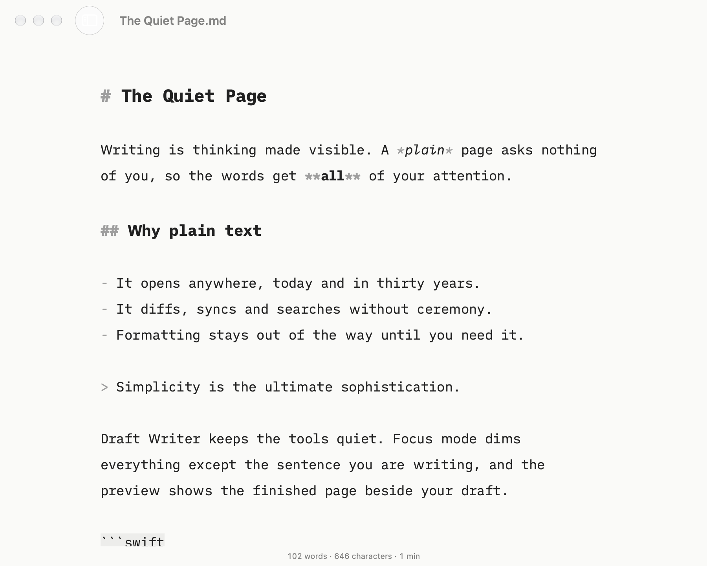
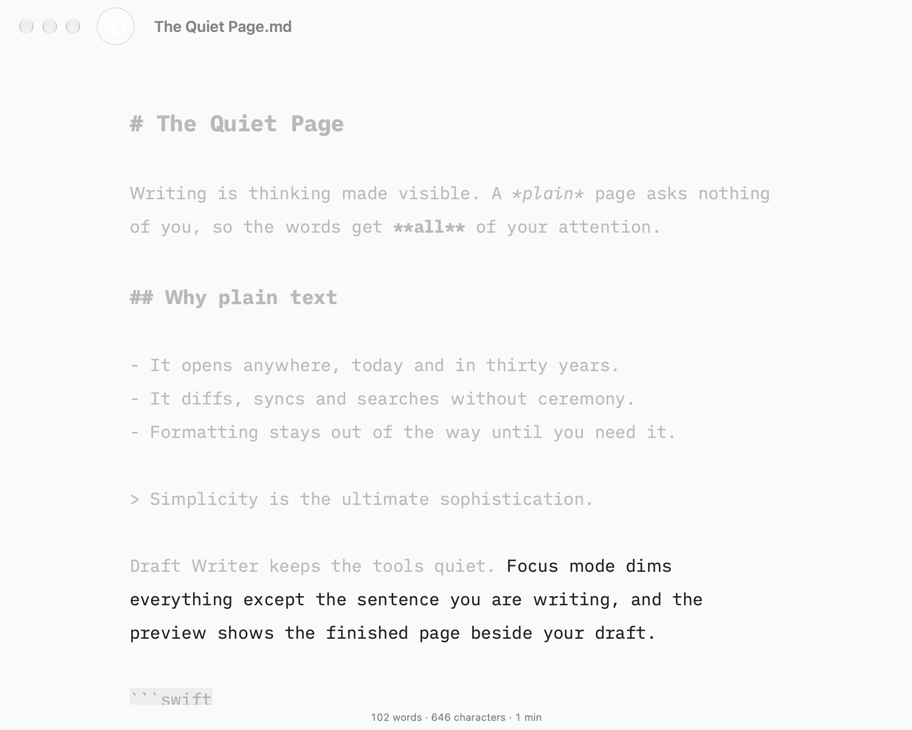
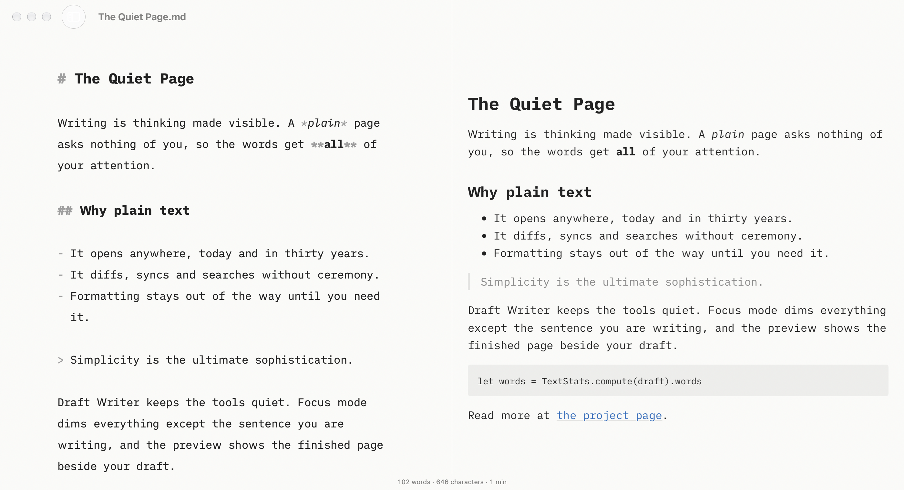
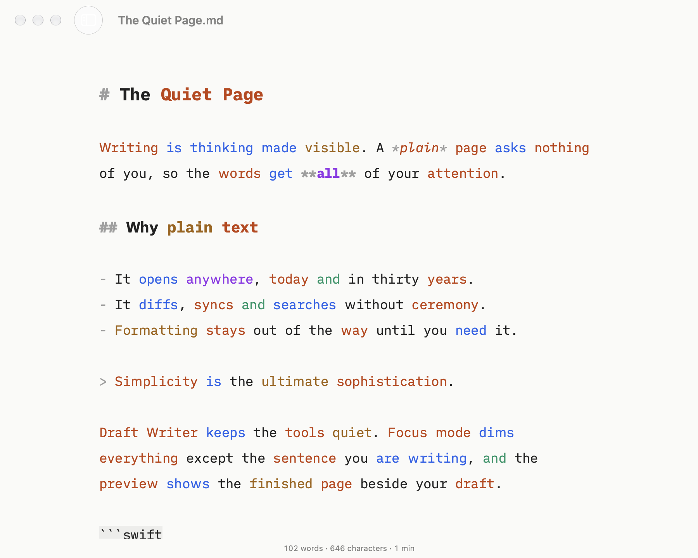
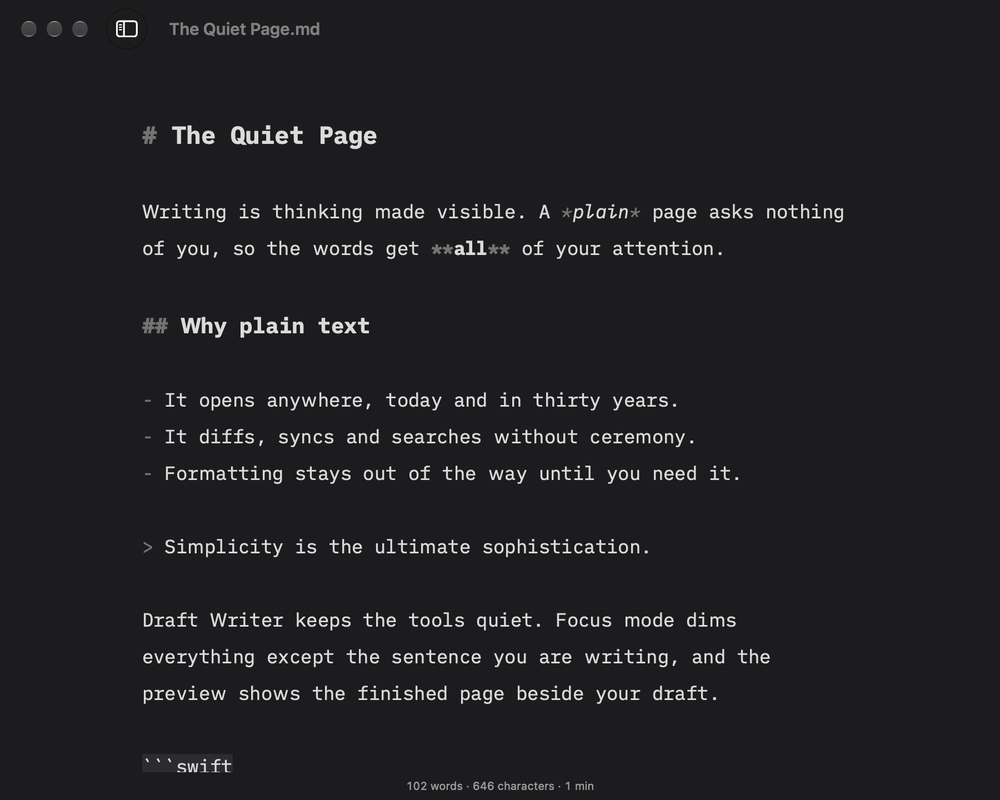

# Draft Writer

A calm, distraction-free Markdown editor for macOS, inspired by [iA Writer](https://ia.net/writer).
Your files stay plain `.md` text: Draft Writer only changes how they look while you write.

## Features

- Native Mac documents: autosave, versions, tabs, Open Recent, iCloud Drive
- iA Writer Duo, Mono and Quattro fonts in a centred, fixed-width column
- Markdown styled as you type: headings, bold, italic, code, links, lists, quotes (markup stays visible)
- Focus mode: dims everything but the current sentence or paragraph
- Typewriter scrolling: the line you type stays in the middle of the window
- Word count, character count and reading time (for the selection when there is one)
- Light, dark and automatic appearance
- Live preview beside the editor that follows your scrolling (GitHub-flavoured Markdown: tables, task lists, strikethrough)
- Export to self-contained HTML or paginated PDF (A4 or US Letter), and print
- Syntax highlighting: colour nouns, verbs, adjectives, adverbs and conjunctions (English, French,
  German, Spanish and the other languages Apple's NaturalLanguage tags; others, such as Swedish, stay plain)
- Library sidebar: browse, search (names and contents), rename and trash the notes in one folder;
  new notes in the selected folder

## Screenshots

Focus mode keeps only the sentence you're writing bright:

The live preview sits beside the editor and follows your scrolling:

Syntax highlighting colours nouns, verbs, adjectives, adverbs and conjunctions:

Dark appearance:

## Shortcuts

| Shortcut | Action |
|---|---|
| ⌘D | Focus mode: off → sentence → paragraph |
| ⇧⌘T | Typewriter scrolling |
| ⌘R | Show or hide the preview |
| ⇧⌘E | Export as HTML |
| ⌘P | Print |
| ⇧⌘H | Syntax highlighting (View > Highlight picks the word classes) |
| ⌘1 | Show or hide the library |
| ⌥⌘N | New note in the library |
| ⌘, | Settings (font, size, line width, appearance) |

## Build

Requires macOS 15+ and Xcode 26+.

    brew install xcodegen
    xcodegen generate
    open DraftWriter.xcodeproj

The Xcode project is generated from `project.yml` and is not committed.

Relative images (``) appear in the preview and exports for notes inside your library
folder. For files elsewhere, the sandbox only grants access to the open file itself, not its neighbours.
Raw HTML in documents is not rendered.

## Tests

    cd Packages/DraftKit && swift test                                   # text logic
    cd Packages/DraftKit && swift test -c release --filter PerformanceTests
    xcodebuild -scheme DraftWriter -destination 'platform=macOS' test -only-testing:DraftWriterTests

`DraftWriterUITests` drives the real app and needs an unlocked screen with UI automation allowed.
`scripts/make-fixture.swift` regenerates the 50,000-word performance fixture.
`scripts/screenshots.sh` re-renders the README screenshots from the real window, offscreen, so it works
on a headless Mac.

## Layout

- `Packages/DraftKit`: UI-free text logic (Markdown styling, focus ranges, stats, decoding), built on
  Apple's [swift-markdown](https://github.com/swiftlang/swift-markdown) and NaturalLanguage
- `DraftWriter/`: the SwiftUI + AppKit app
- `docs/superpowers/`: design spec and implementation plans

## Credits

Fonts: [iA Writer Duo, Mono and Quattro](https://github.com/iaolo/iA-Fonts) by Information
Architects Inc., under the SIL Open Font License (see `DraftWriter/Resources/Fonts/LICENSE.md`).

## License

MIT
