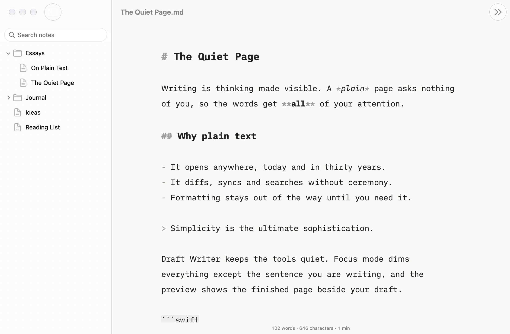

# Draft Writer

A calm, distraction-free Markdown editor for macOS, inspired by [iA Writer](https://ia.net/writer).
Your files stay plain `.md` text: Draft Writer only changes how they look while you write.

## Features

- Native Mac documents: autosave, versions, tabs, Open Recent, iCloud Drive
- iA Writer Duo, Mono and Quattro fonts in a centred, fixed-width column
- Markdown styled as you type: headings, bold, italic, strikethrough, code, links, images, lists, quotes, tables,
  thematic breaks (markup stays visible)
- Markdown shortcuts: ⌘B / ⌘I / ⌘K wrap the selection; Return continues lists, quotes and tasks (renumbering
  ordered lists); Tab / ⇧Tab indent list items; ⇧⌘L toggles a task; ⌘-click opens links
- Focus mode: dims everything but the current sentence or paragraph
- Typewriter scrolling: the line you type stays in the middle of the window
- Word, sentence and character counts (with and without spaces) and reading time, for the selection when there
  is one; click the counts to set a per-document word goal and see progress
- Light, dark and automatic appearance
- Live preview beside the editor that follows your scrolling (GitHub-flavoured Markdown: tables, task lists, strikethrough)
- Export to self-contained HTML, paginated PDF (A4 or US Letter) or Word (.docx), and print
- Custom templates: choose a folder of CSS in Settings to restyle the preview and HTML/PDF exports
- Content blocks: a line that is just `/chapter-2.md` or `/figure.png` embeds that file (next to the document)
  in the preview and exports
- Syntax highlighting: colour nouns, verbs, adjectives, adverbs and conjunctions (English, French,
  German, Spanish and the other languages Apple's NaturalLanguage tags; others, such as Swedish, stay plain)
- Style check: highlight fillers, clichés and redundancies in English text (View > Highlight)
- Library sidebar: browse, search (names and contents), rename and trash the notes in one folder;
  new notes in the selected folder
- `[[Wikilinks]]` between library notes (⌘-click opens or creates the note) and `#tags`, listed in the sidebar
- Quick Open (⇧⌘O) for any library note, and Jump to Heading (⇧⌘J)

## Screenshots

Focus mode keeps only the sentence you're writing bright:

The live preview sits beside the editor and follows your scrolling:

Syntax highlighting colours nouns, verbs, adjectives, adverbs and conjunctions:

The library sidebar shows one folder of notes as a tree, with search across names and contents:

Dark appearance:

## Shortcuts

| Shortcut | Action |
|---|---|
| ⌘D | Focus mode: off → sentence → paragraph |
| ⇧⌘T | Typewriter scrolling |
| ⌘R | Show or hide the preview |
| ⇧⌘E | Export as HTML |
| ⌘P | Print |
| ⇧⌘H | Syntax highlighting (View > Highlight picks the word classes and style checks) |
| ⌘B / ⌘I / ⌘K | Bold / italic / link |
| ⇧⌘L | Toggle a task checkbox |
| ⇧⌘O | Quick Open a library note |
| ⇧⌘J | Jump to a heading |
| ⌘1 | Show or hide the library |
| ⌥⌘N | New note in the library |
| ⌘, | Settings (font, size, line width, appearance) |

## Install

Draft Writer runs on macOS 15 or later.

**Download.** Grab the zip from the [latest release](https://github.com/manuel-palacio/draft-writer/releases/latest),
unzip it and move `Draft Writer.app` into Applications. The app isn't signed with an Apple Developer ID, so macOS
blocks it the first time. Try to open it once, then go to System Settings > Privacy & Security and
click **Open Anyway**. Running this in Terminal does the same:

    xattr -dr com.apple.quarantine "/Applications/Draft Writer.app"

**Build it yourself.** Install Xcode 26 or later from the App Store, then:

    brew install xcodegen
    git clone https://github.com/manuel-palacio/draft-writer.git
    cd draft-writer
    xcodegen generate
    xcodebuild -project DraftWriter.xcodeproj -scheme DraftWriter -configuration Release \
      -derivedDataPath .build/release build
    cp -R ".build/release/Build/Products/Release/Draft Writer.app" /Applications/

To update, pull the latest code, run the build again and replace the app.

## Build

For development. Requires macOS 15+ and Xcode 26+.

    brew install xcodegen
    xcodegen generate
    open DraftWriter.xcodeproj

The Xcode project is generated from `project.yml` and is not committed.

Relative images (``) appear in the preview and exports for notes inside your library
folder. For files elsewhere, the sandbox only grants access to the open file itself, not its neighbours.
Images reached through a symlink that points outside the note's folder are not shown: the preview only
loads files that really live inside it.
Raw HTML in documents is not rendered.

## Tests

    cd Packages/DraftKit && swift test                                   # text logic
    cd Packages/DraftKit && swift test -c release --filter PerformanceTests
    xcodebuild -scheme DraftWriter -destination 'platform=macOS' test -only-testing:DraftWriterTests

`DraftWriterUITests` drives the real app and needs an unlocked screen with UI automation allowed. Debug builds
read a `DRAFT_LIBRARY_FIXTURE` environment variable (JSON, relative path → text) that the UI tests use to give
the sandboxed app a library.
`scripts/make-fixture.swift` regenerates the 50,000-word performance fixture.
`scripts/screenshots.sh` re-renders the README screenshots from the real window, offscreen, so it works
on a headless Mac.

## Layout

- `Packages/DraftKit`: UI-free text logic (Markdown styling, focus ranges, stats, decoding), built on
  Apple's [swift-markdown](https://github.com/swiftlang/swift-markdown) and NaturalLanguage
- `DraftWriter/`: the SwiftUI + AppKit app
- `docs/superpowers/`: design spec and implementation plans

## Credits

Fonts: [iA Writer Duo, Mono and Quattro](https://github.com/iaolo/iA-Fonts) by Information
Architects Inc., under the SIL Open Font License (see `DraftWriter/Resources/Fonts/LICENSE.md`).

## License

MIT
